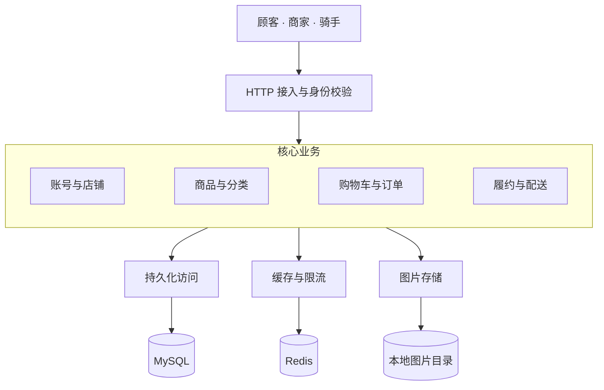

# 项目分层总览、入口与数据存储

这是一个面向顾客、商家和骑手的 Spring Boot 单体应用：MySQL 保存业务事实，Redis 辅助商品缓存、请求限流、骑手坐标记录和可接配送任务的空间索引，本地目录保存商品图片。

## 30 秒理解项目结构

从上向下读 **HTTP 接入 → 核心业务 → 共享访问能力 → 存储**。四个业务框是同一 JVM 内的职责分组，不是独立部署的服务。

这张图只表达分层。共享访问能力是现有代码的归类，没有额外的统一仓储或缓存网关；业务按需使用 Redis 和文件系统。定时任务也会进入业务层，见后文调度表。

## 选择下一步阅读

| 想回答的问题 | 阅读位置 |
| --- | --- |
| 哪些模块相互依赖？ | [07 模块依赖](07-module-dependencies.md) |
| 下单何时开启事务，如何避免重复创建？ | [02 订单创建](02-order-creation.md) |
| 支付、接单、出餐和配送如何改变状态？ | [03 订单状态与履约](03-order-lifecycle.md) |
| 详情缓存如何读取、重建、降级与补偿？ | [04 商品缓存](04-product-cache.md) |
| 购物车如何绑定商家、修改数量和被下单消费？ | [05 购物车](05-cart.md) |
| 当前实现有哪些限制或不一致？ | [06 问题记录](06-findings.md) |

## 主要入口

| 使用方 | HTTP 入口与职责 | 入口类 |
| --- | --- | --- |
| 公开访问 | 账号注册/登录；`/api/customer/shops` 店铺浏览 | [UserController](../../src/main/java/org/example/takeout/User/Controller/UserController.java)、[CustomerShopController](../../src/main/java/org/example/takeout/Merchant/Controller/CustomerShopController.java)；商家、骑手也有注册/登录接口 |
| 顾客 | `/cart/items` 购物车；`/order` 创建、查询、支付、取消、签收 | [CartController](../../src/main/java/org/example/takeout/Cart/Controller/CartController.java)、[OrderController](../../src/main/java/org/example/takeout/Order/Controller/OrderController.java) |
| 商家 | `/category`、`/category/products` 商品分类；`/merchant` 资料、履约、订单已读和 SSE | [CategoryController](../../src/main/java/org/example/takeout/Category/Controller/CategoryController.java)、[ProductController](../../src/main/java/org/example/takeout/Product/Controller/ProductController.java)、[MerchantProductController](../../src/main/java/org/example/takeout/Product/Controller/MerchantProductController.java)、[MerchantControllerSold](../../src/main/java/org/example/takeout/Merchant/Controller/MerchantControllerSold.java) |
| 骑手 | `/rider/location` 本人位置上报、读取和删除；`/rider/delivery-tasks` 查询大厅、抢单和确认送达 | [RiderLocationController](../../src/main/java/org/example/takeout/Rider/Controller/RiderLocationController.java)、[DeliveryTaskController](../../src/main/java/org/example/takeout/DeliveryTask/Controller/DeliveryTaskController.java) |

真正的身份与路由角色校验在 [`JwtInterceptor.preHandle`](../../src/main/java/org/example/takeout/Common/Interceptor/JwtInterceptor.java)，公开路径由 [`AuthPathMatcher`](../../src/main/java/org/example/takeout/Common/Auth/AuthPathMatcher.java) 放行；[`SecurityConfig`](../../src/main/java/org/example/takeout/Config/SecurityConfig.java) 配置无会话并 `permitAll`。拦截器解析 JWT、设置上下文并查库复核账号，请求结束清理上下文。用户和骑手要求正常状态，商家只复核存在，打烊仍可管理店铺。

商品详情 `GET /category/products/{id}` 属于商家接口；公开店铺商品列表直接查库，不经过该详情缓存。业务异常由 [`GlobalExceptionHandle`](../../src/main/java/org/example/takeout/Common/Exception/GlobalExceptionHandle.java) 转成 `Result`，响应体业务码不等同于 HTTP 状态码。

## 必须知道的事务与并发边界

MySQL 本地事务覆盖业务数据写入，无法回滚 Redis 删除、SSE 推送或本地文件操作。没有显式隔离级别的方法使用运行环境默认值。

| 场景 | 关键边界 | 详细说明 |
| --- | --- | --- |
| 注册 | 用户与购物车总表同事务；商家与默认分类同事务 | [07 初始化依赖](07-module-dependencies.md#4-账号注册的初始化依赖) |
| 购物车写入 | 事务内锁住该用户总表；数量修改另检查旧版本 | [05 购物车](05-cart.md) |
| 创建订单 | 准备数据在事务外；插单、购物车消费、扣库存、明细与必要失效任务同事务 | [02 订单创建](02-order-creation.md) |
| 订单取消与支付 | 取消和退库同事务，退库按明细与商品的 `stock_version` 判断；模拟支付两次状态更新同事务，通知在提交后 | [03 订单状态](03-order-lifecycle.md) |
| 出餐、抢单、送达 | 出餐与建配送任务同事务；抢单/送达与订单状态同事务，显式 `READ_COMMITTED` | [03 履约与配送](03-order-lifecycle.md) |
| 配送任务 GEO | 出餐后在主事务提交后按任务状态修复 GEO；单任务修复使用 `REQUIRES_NEW`、`REPEATABLE_READ`，在 `SELECT ... FOR UPDATE` 行锁期间完成 Redis 操作；抢单提交后删除 GEO | [07 模块依赖](07-module-dependencies.md#6-可接配送任务-geo-与接单大厅) |
| 商品与缓存 | 商品写入与必要失效任务同事务；提交后删缓存，调度重试补偿 | [04 商品缓存](04-product-cache.md) |

唯一键、条件更新和行锁承担不同职责：订单由 `(user_id, request_id)` 唯一键兜底；购物车使用总表 `FOR UPDATE`；扣库存先锁定商品行读取 `stock_version`，再以状态、余量和该版本条件更新；退库以订单明细记录的版本为条件，扣库与退库都按商品 ID 升序处理。商家接单只有条件更新，没有显式多语句事务。详细锁范围与重放条件留在对应业务文档，不从分层图推断。

## 数据放在哪里

| 存储 | 当前内容与边界 |
| --- | --- |
| MySQL | `user/merchant/rider` 账号；`merchant.longitude/latitude` 店铺取货坐标；`category/product` 商品；`cart_header/cart` 购物车；`orders/order_item` 订单快照；`delivery_task` 配送状态与建任务时的 `pickup_longitude/pickup_latitude` 坐标快照；`cache_invalidation_task` 缓存失效任务 |
| Redis | 商品详情与空值、重建锁、下单限流、登录失败计数；骑手位置 GEO `rider:locations` 与最近活跃时间 ZSET `rider:last_active`；可接配送任务 GEO `delivery:available:geo`。各自的故障处理不同，真实购物车和订单仍在 MySQL |
| JVM 内存 | 商家 SSE 连接表；每商家在当前实例最多一条连接，无持久化事件或跨实例广播 |
| 本地文件 | `./uploads/products`；MySQL 只保存图片 URL。上传与商品保存不共事务，孤儿清理保留逻辑删除商品仍引用的图片 |

`cart_header` 以用户为主键，商家绑定可空；购物车明细以用户与商品唯一，订单请求以用户与 requestId 唯一，配送任务以订单唯一。不能把所有 `*_id` 都理解为数据库外键。表结构依据是 [初始结构](../../src/main/resources/db/migration/B20261008__initial_schema.sql) 与 [后续迁移目录](../../src/main/resources/db/migration)，并非对当前数据库实例的探测。

[`FlywayConfig.flywayMigrationRunner`](../../src/main/java/org/example/takeout/Config/FlywayConfig.java) 执行运行时迁移，位置由 [`application.yaml`](../../src/main/resources/application.yaml) 指向 `classpath:db/migration`；[`compose.yaml`](../../compose.yaml) 还为新容器数据库挂载初始化脚本。脚本存在不等于某个部署已执行。

## 定时入口

这些调度在同一应用内运行，不经过 HTTP 鉴权，也没有消息队列消费者。

| 入口与源码 | 作用与频率 |
| --- | --- |
| [OrderTimeoutTask.cancelTimeoutOrders](../../src/main/java/org/example/takeout/Order/Config/OrderTimeoutTask.java) | 默认每轮完成后 60 秒扫描，逐单事务取消；可关闭或调整频率 |
| [CacheInvalidationTaskScheduler](../../src/main/java/org/example/takeout/CacheInvalidationTask/Config/CacheInvalidationTaskScheduler.java) | 每轮完成后 10 秒重试待处理任务、1 小时重试失败任务；另每轮完成后 1 小时清理创建满 7 天的 SUCCESS，最多 1000 条；无任务领取锁 |
| [RiderLocationCleanupScheduler](../../src/main/java/org/example/takeout/Rider/Config/RiderLocationCleanupScheduler.java) | 每轮完成后等待 5 分钟，清理最近活跃时间不晚于 5 分钟前的骑手位置；每轮最多 10 批、每批 100 条 |
| [DeliveryTaskGeoReconciliationJob](../../src/main/java/org/example/takeout/DeliveryTask/Config/DeliveryTaskGeoReconciliationJob.java) | 默认启动后等待 10 分钟，之后每轮完成后等待 10 分钟；一次查询 MySQL 全部待接任务，并一次读取 Redis GEO 全部成员，只修复两边 ID 对称差集中的任务；单任务事务锁行并在锁内更新 Redis。可通过 `delivery.geo.reconciliation.enabled` 关闭 |
| [MerchantSseSchedule.schedule](../../src/main/java/org/example/takeout/Merchant/Config/MerchantSseSchedule.java) | 每 30 秒发送当前实例 SSE 心跳 |
| [ProductImageCleanupService.cleanupOrphanImages](../../src/main/java/org/example/takeout/Product/Config/ProductImageCleanupService.java) | 每轮完成后 12 小时清理修改时间超过 24 小时且无引用的图片 |

## 源码定位与已实现范围

[`pom.xml`](../../pom.xml) 是单个 Maven 工程，Java 17、Spring Boot 4.0.6；[`TokeoutApplication`](../../src/main/java/org/example/takeout/TokeoutApplication.java) 开启调度与 Mapper 扫描。Mapper、MyBatis-Plus 和 SQL 构成持久化访问；Converter 与展示汇总类不另开事务。

| 业务分组 / 能力 | 主要源码入口 |
| --- | --- |
| 账号与店铺 | [UserService](../../src/main/java/org/example/takeout/User/Service/UserService.java)、[MerchantAccountService](../../src/main/java/org/example/takeout/Merchant/Service/MerchantAccountService.java)、[RiderService](../../src/main/java/org/example/takeout/Rider/Service/RiderService.java)、[CustomerShopQueryService](../../src/main/java/org/example/takeout/Merchant/Service/CustomerShopQueryService.java) |
| 商品与分类 | [ProductService](../../src/main/java/org/example/takeout/Product/Service/ProductService.java)、[CategoryService](../../src/main/java/org/example/takeout/Category/Service/CategoryService.java) |
| 购物车与订单 | [CartService](../../src/main/java/org/example/takeout/Cart/Service/CartService.java)、[OrderService](../../src/main/java/org/example/takeout/Order/Service/OrderService.java)、[OrderTransactionExecutor](../../src/main/java/org/example/takeout/Order/Service/OrderTransactionExecutor.java) |
| 履约与配送 | [FulfillmentService](../../src/main/java/org/example/takeout/Merchant/Service/FulfillmentService.java)、[DeliveryTaskService](../../src/main/java/org/example/takeout/DeliveryTask/Service/DeliveryTaskService.java)、[DeliveryTaskGeoService](../../src/main/java/org/example/takeout/DeliveryTask/Service/DeliveryTaskGeoService.java) |
| 骑手位置与接单大厅 | [RiderLocationController](../../src/main/java/org/example/takeout/Rider/Controller/RiderLocationController.java)、[RiderLocationService](../../src/main/java/org/example/takeout/Rider/Service/RiderLocationService.java)、[DeliveryTaskController](../../src/main/java/org/example/takeout/DeliveryTask/Controller/DeliveryTaskController.java) |
| 共享访问能力 | [MybatisPlusConfig](../../src/main/java/org/example/takeout/Config/MybatisPlusConfig.java)、[RedisCacheClient](../../src/main/java/org/example/takeout/Common/Redis/RedisCacheClient.java)、[ProductImageService](../../src/main/java/org/example/takeout/Product/Service/ProductImageService.java) |

支付由 `OrderService.paying()`、商家拒单退款由 `OrderCommandService.refunding()` 固定返回成功，配送奖励由 [`DeliveryFeeCalculator`](../../src/main/java/org/example/takeout/DeliveryTask/Domain/DeliveryFeeCalculator.java) 固定返回 5；未实现外部支付/退款、支付失败异步回调、自动签收或配送取消。骑手使用 `/rider/location` 操作本人位置，接单大厅使用该位置和任务 GEO 对候选任务排序。正常 GEO 查询最多取 100 个附近候选，但随后从 MySQL 读取并返回全部待接任务：候选按距离升序排在前面，其余按任务 ID 升序；若骑手位置查询或任务 GEO 查询失败、或附近候选为空，则降级为按任务 ID 倒序返回最多 500 条。骑手没有位置时仍提示先上报。任务 GEO 是 MySQL 状态的索引，不决定能否接单。出餐事务提交后按任务上的商家坐标快照修复索引；快照缺失时跳过 GEO 写入。定时对账一次读取 MySQL 全量待接 ID 和 Redis 全量 GEO 成员，按成员差集逐任务执行 `REQUIRES_NEW`、`REPEATABLE_READ` 事务，以 `SELECT ... FOR UPDATE` 锁行至 Redis 更新完成；成员 ID 已在两侧交集时不会比较或校正其坐标。实验包中的 [RedisHashCartServiceExperiment](../../src/main/java/org/example/takeout/Experiment/RedisHashCartServiceExperiment.java) 与 [RedisSetFollowServiceExperiment](../../src/main/java/org/example/takeout/Experiment/RedisSetFollowServiceExperiment.java) 没有实际 Controller/业务 Service 调用，不视为正式购物车或推荐能力。
