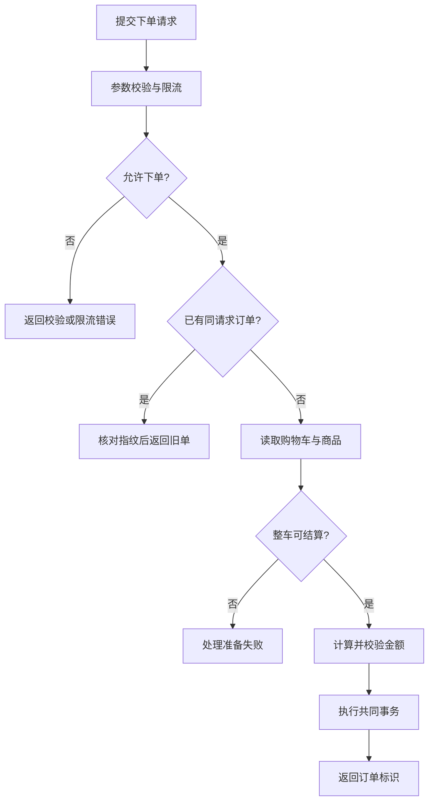
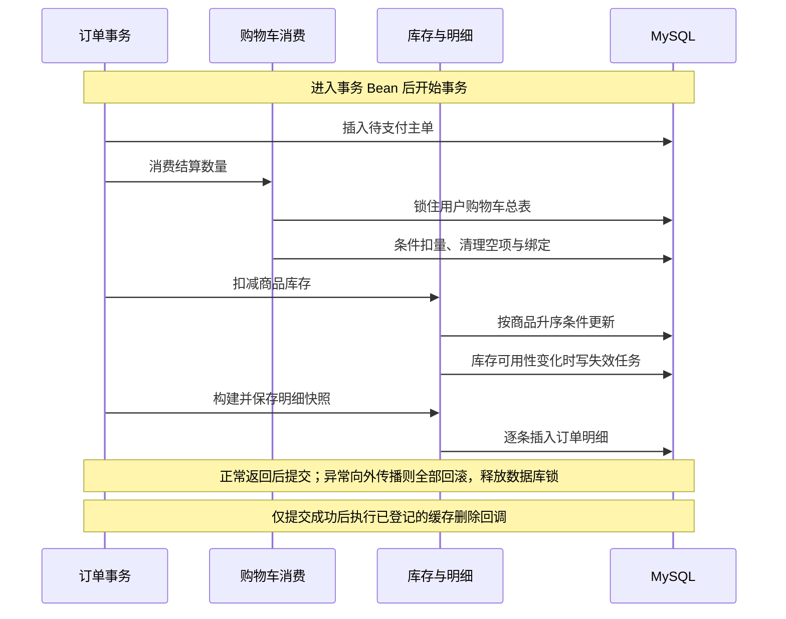

# 订单创建：从购物车到待支付订单

将当前用户的整车商品结算为待支付订单，并让订单、购物车消费、库存和明细共同提交或回滚。

## 1. 主流程：一次下单经过什么

入口为 `POST /order`。本图只展示业务路径；幂等冲突、共同事务和并发保护在后文展开。

`OrderService.createOrder` 本身没有事务：幂等预查、读取购物车、商家与商品、校验和计价都在创建事务之前，也没有锁住购物车或商品。准备失败只有 `CART_EMPTY` 会再次查同请求订单；找到且指纹一致则返回旧单，否则保留原异常。金额校验或共同事务失败也直接向外传播。

## 2. 子流程：新订单怎样共同提交

下图只展开新订单成功路径；唯一键冲突的提前返回见后面的幂等表。

“订单事务”是 `OrderTransactionExecutor`；“购物车消费”是 `CartCommandService`；“库存与明细”合并表示 `OrderItemService → ProductCommandService`，不代表新增服务。事务由 Spring 代理管理，`rollbackFor = Exception.class`；购物车消费和失效任务写入使用 `MANDATORY`，库存操作以默认 `REQUIRED` 加入该事务。没有显式指定隔离级别。

### 幂等：哪些情况返回旧订单

幂等键为 `(user_id, request_id)`，数据库唯一索引负责最终仲裁。下面三处保护发生在不同阶段，不能合并理解为“失败自动重试”。

| 检查位置 | 命中时 | 未命中或冲突时 |
| --- | --- | --- |
| 结算准备前查单 | 指纹一致则返回旧单 | 没有订单才准备结算；指纹不同则参数错误 |
| 准备抛 `CART_EMPTY` 后再查单 | 指纹一致则返回旧单 | 查不到则抛原异常；其他准备异常不补查 |
| 事务内插主单遇唯一键冲突 | 按用户与请求号找到同指纹订单则返回，不消费车、不扣库存 | 指纹不同则参数错误；查不到则重抛唯一键异常 |

第三处只捕获主单插入处的 `DuplicateKeyException`。后续库存、明细等异常不会转为幂等成功；订单号唯一键冲突且找不到同请求订单时，也没有重新生成订单号的重试。

## 3. 关键设计说明

- **按整车结算。** 请求只携带请求号、收货信息与备注，商品和金额来自数据库。任一条目不可用会拒绝整车；可用条件是商品存在、未删除、已上架，绑定商家存在且未打烊。结算不走商品详情 Redis 缓存。
- **结算数据是事务外快照。** 明细的名称、价格取自准备阶段，扣库存后不重新计价。总额上限为 `1,000,000`，目前没有配送费或优惠计算；原价等于总额、优惠为零。图片依次取商品图、购物车图、默认图。
- **购物车锁保护消费。** 事务内对用户 `cart_header` 执行 `FOR UPDATE`，逐项要求现有数量不少于结算快照数量，再扣减并删除零数量条目；只有车中再无条目才解绑商家。总表锁持有到事务结束。
- **库存按固定顺序更新。** 按商品 ID 升序扣库；每件商品先 `SELECT ... FOR UPDATE` 锁定商品行并读取 `stock_version`，再执行同时要求该版本、未删除、已上架、库存充足的扣减 SQL。订单明细保存本次实际扣减对应的 `stock_version`，而不是准备阶段商品快照中的版本。`version + 1` 没有匹配旧版本的条件，这条路径依靠行锁和条件更新，没有乐观锁重试；扣完变零则改为售罄。
- **缓存失效不提前发生。** 库存从有货变无货时，同事务写入失效任务并登记提交回调；提交后才删除 Redis。任务写入异常会回滚订单，提交后的 Redis 删除故障仅记录日志，由任务补偿，见 [04 商品缓存](04-product-cache.md)。

## 4. 异常与边界情况

| 情况 | 实际结果 |
| --- | --- |
| 限流 Redis 故障或返回空结果 | 放行；正常限额为每用户 10 秒 5 次，键 TTL 为 15 秒。重放旧订单也先限流，放行后的业务失败不返还额度 |
| 同请求号修改收货信息或备注 | SHA-256 指纹不一致，拒绝；`null` 与空串也不同 |
| 同请求号但购物车已经改变 | 指纹不含商品、数量、金额或商家，仍可能返回旧订单 |
| 准备后继续加购 | 只消费快照数量，新加数量与条目保留；车未空则不解绑 |
| 准备后被减量、删项或库存不足 | 条件更新失败，创建事务全部回滚；不自动重新结算 |
| 商品、明细或失效任务写入异常 | 主单、车、绑定、库存、明细与失效任务共同回滚，不执行提交回调 |

价格与商家状态的时效窗口、结算未再次核对商品所属商家、总表锁记录缺失的防御边界见 [06 问题与待确认事项](06-findings.md)。这些是当前实现的限制，图中没有补画价格锁定、购物车版本校验或业务自动重试。

## 5. 源码定位

| 职责 | 关键类与方法 |
| --- | --- |
| HTTP 与限流 | [OrderController.create](../../src/main/java/org/example/takeout/Order/Controller/OrderController.java)、[OrderCreateRateLimiter.tryAcquire](../../src/main/java/org/example/takeout/Order/Limited/OrderCreateRateLimiter.java) |
| 幂等与结算 | [OrderService.createOrder / prepareOrderDataContext](../../src/main/java/org/example/takeout/Order/Service/OrderService.java)、[OrderRequestFingerprint.calculate](../../src/main/java/org/example/takeout/Order/Support/OrderRequestFingerprint.java)、[CartCheckoutService.prepareCheckout](../../src/main/java/org/example/takeout/Cart/Service/CartCheckoutService.java) |
| 创建事务与明细 | [OrderTransactionExecutor.executeOrderCreation](../../src/main/java/org/example/takeout/Order/Service/OrderTransactionExecutor.java)、[OrderItemService.decreaseStocksOrderedByProductId / buildOrderItems / saveBatch](../../src/main/java/org/example/takeout/Order/Service/OrderItemService.java) |
| 购物车锁与消费 SQL | [CartCommandService.consumeCheckedOutItems](../../src/main/java/org/example/takeout/Cart/Service/CartCommandService.java)、[CartHeaderMapper.lockCartHeader](../../src/main/java/org/example/takeout/CartHeader/Mapper/CartHeaderMapper.java)、[CartMapper.consumeQuantity](../../src/main/java/org/example/takeout/Cart/Mapper/CartMapper.java) |
| 库存与缓存失效 | [ProductCommandService.decreaseStock](../../src/main/java/org/example/takeout/Product/Service/ProductCommandService.java)、[ProductMapper.decreaseStock](../../src/main/java/org/example/takeout/Product/Mapper/ProductMapper.java)、[CacheInvalidationTaskService.requestInvalidation](../../src/main/java/org/example/takeout/CacheInvalidationTask/Service/CacheInvalidationTaskService.java) |
| 唯一约束 | [初始 schema 的 orders 定义](../../src/main/resources/db/migration/B20261008__initial_schema.sql)、[用户与请求号唯一索引迁移](../../src/main/resources/db/migration/V20261005__orders_user_request_uniqueness.sql) |

本页按当前源码核对，未连接数据库或 Redis，也未运行测试。事务与幂等的测试线索为 [OrderCartHeaderTransactionTest](../../src/test/java/org/example/takeout/Order/Service/OrderCartHeaderTransactionTest.java) 和 [OrderTransactionExecutorIdempotencyTest](../../src/test/java/org/example/takeout/Order/Service/OrderTransactionExecutorIdempotencyTest.java)。下一步阅读 [03 订单状态与履约](03-order-lifecycle.md)。
