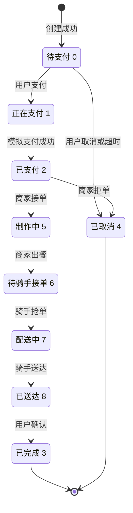
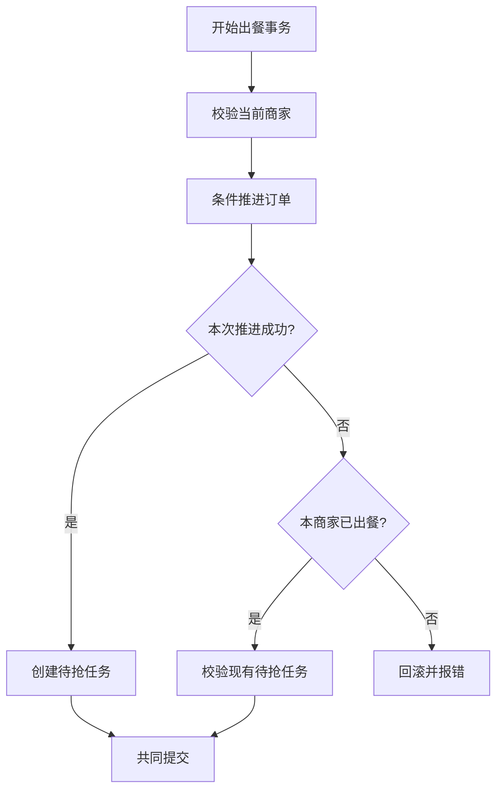
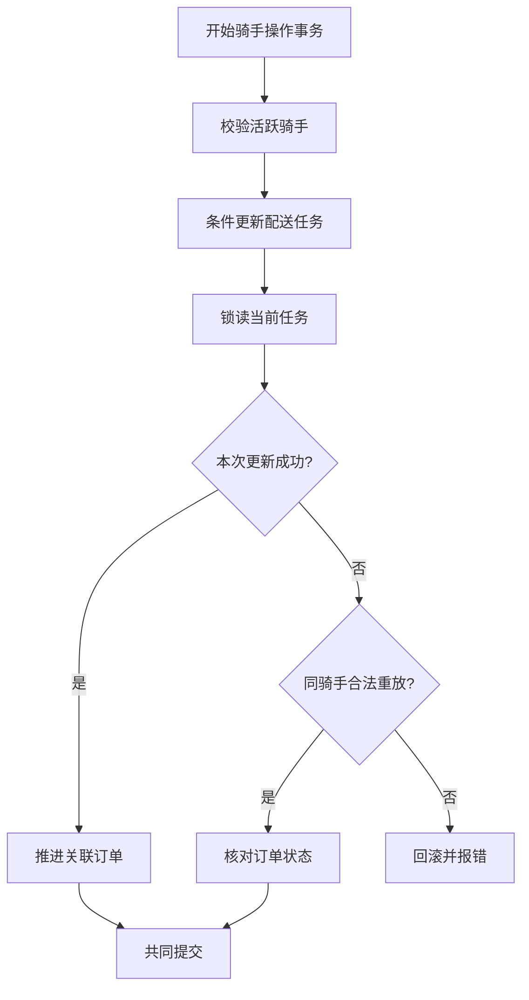
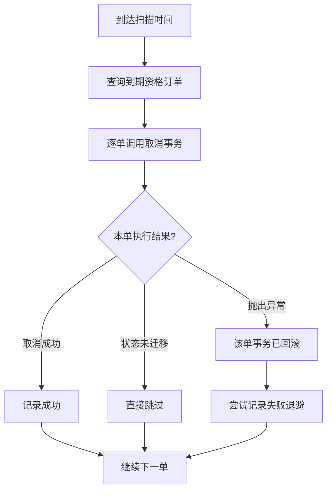

# 订单状态、履约与超时取消

通过受身份与旧状态约束的更新推进订单，并在出餐、抢单、送达和取消时维护关联数据的一致性。

## 1. 主流程：订单可以怎样变化

**支付的 `0→1→2` 在同一个事务内完成，状态 1 不单独提交；中途失败整体回滚到 0。** `paying()` 当前恒为 `true`，不是外部支付接口。取消分为三类：用户取消和超时取消仅从待支付发起，商家拒单仅从已支付发起；三者都写 `cancel_source`（1 用户、2 商家、3 超时）并与退库共同提交，商家拒单还调用恒为 `true` 的 `refunding()`。图中终态仅表示代码没有后继迁移。

配送任务是另一张表，状态分别为待抢 `0`、配送中 `1`、完成 `2`，不能与订单状态码混用。出餐才创建任务，抢单即开始配送；没有单独的取餐状态。

## 2. 子流程：需要一起成功的操作

### 2.1 出餐：何时创建配送任务

订单从制作中改为待接单后才插入任务，`delivery_task.order_id` 唯一索引限制每单一条。合法重放要求已有任务处于待抢且未绑定骑手；缺任务或状态不符会报错，**不自动补建**。商家不存在、任务插入失败或校验失败都会回滚。本流程由 `FulfillmentService.completePreparation` 开启 `READ_COMMITTED` 事务。

新任务同时保存商家取货经纬度快照。商家已配置坐标时，在出餐事务提交后调用单任务 GEO 对账；未配置则只保留 MySQL 任务，不进入附近候选。GEO 回调失败只记录日志，不回滚已提交的订单与任务，由定时对账补偿；商家之后修改坐标不会改变现有任务快照。

### 2.2 骑手操作：任务和订单如何同步

抢单与送达使用相同控制结构，只有迁移条件不同，因此共用一张图。

“锁读”是更新之后执行的 `SELECT ... FOR UPDATE`，**不论更新影响几行都会执行**，锁持有至事务结束。两个入口均显式使用 `READ_COMMITTED`；图中任一骑手校验、订单推进、重放校验或数据库操作抛异常，整个事务回滚。

| 操作 | 任务条件更新 | 随后的订单更新 | 允许的重放 |
| --- | --- | --- | --- |
| 抢单 | 待抢 `0→1`，要求尚无骑手；写骑手与接单时间 | 待接单 `6→7` | 任务已为 1 且属于当前骑手，订单必须仍为 7 |
| 送达 | 配送中 `1→2`，要求当前骑手；写送达时间 | 配送中 `7→8` | 任务已为 2 且属于当前骑手，订单必须为 8 或 3 |

抢单成功提交后删除任务 GEO；删除失败会尝试单任务对账，再失败等待定时补偿。GEO 修复另用 `REQUIRES_NEW`、`REPEATABLE_READ` 和 `SELECT ... FOR UPDATE`，行锁覆盖 Redis 操作，与抢单的条件更新互斥。任务大厅用 MySQL 过滤状态，索引残留不会赋予已领取任务再次接取的资格。具体查询、全量差集对账和容量边界见[模块依赖中的 GEO 说明](07-module-dependencies.md#6-可接配送任务-geo-与接单大厅)。

### 2.3 超时扫描：哪些失败会推迟重试

扫描本身没有批次事务或分布式锁。默认首次等待 60 秒，每轮完成后再等待 60 秒，可通过 `order.timeout` 属性调整间隔、初始延迟或关闭调度。每轮查询资格时间不晚于本轮扫描时间的待支付订单，按资格时间、ID 升序取最多 100 条。

**每单独立事务**依次执行：条件取消（仍为待支付且创建已满 30 分钟）→ 查询明细 → 按商品 ID 升序退库（仅当明细 `stock_version` 仍等于商品当前库存基准）→ 必要时写缓存失效任务 → 提交。版本不一致的明细跳过回补；条件更新未影响一行就返回 `false`，不读明细、不退库；其他异常使本单全部回滚，再由扫描器单独更新退避时间。

退避只针对抛异常的订单，将仍待支付订单的资格时间改为数据库当前时间后 30 分钟。该更新不检查影响行数；退避本身失败只记录日志，下一轮可能再次选中。

## 3. 关键设计说明

- **状态更新也是并发仲裁。** 状态 SQL 带旧状态条件，用户和商家操作还带所属身份；受影响行数决定迁移是否成功。支付、主动取消、超时取消和商家拒单竞争同一订单行，只有成功取消的事务才进入退库；退库 SQL 再以 `stock_version` 条件决定该明细是否真正回补。
- **跨表变更共同提交。** 出餐将订单与新任务置于同一事务；抢单、送达将任务与订单置于同一事务。商家接单只改订单，没有显式服务事务，HTTP 路径按数据源自动提交；商家拒单在订单命令服务内开事务，订单状态、`cancel_source`、模拟退款和退库一起提交。
- **退库与取消不可分开。** 明细缺失或退库 SQL 异常会撤销取消；商品物理缺失或库存版本不一致时，该明细跳过回补，但不阻止订单取消提交。退库允许更新逻辑删除商品；只把未删除且原为售罄的商品恢复上架，不恢复手工下架商品。库存跨过零边界时写失效任务，提交后删缓存，见 [04 商品缓存](04-product-cache.md)。
- **支付通知在提交之后。** `payOrder` 登记 `afterCommit` 再调用商家 SSE；没有连接就返回，发送异常则移除连接并记录日志。连接是进程内每商家一个，并非可靠消息队列。

## 4. 异常与边界情况

| 入口或场景 | 事务与重复调用边界 |
| --- | --- |
| 用户支付 | 同事务 `0→1→2` 并写支付时间；要求创建时间严格晚于当前时间减 30 分钟。重复支付失败，回滚不发通知 |
| 用户取消 | 同事务改为 4、写 `cancel_source=1` 并退库；当前用户订单已为 4 时成功返回，不重复退库，其他状态失败 |
| 商家拒单 | 同事务 `2→4`、写 `cancel_source=2`、模拟退款并退库；本商家订单已是 4 且来源为 2 时成功返回，其他状态失败 |
| 商家接单 | 只允许本商家 `2→5`；本商家订单已为 5 时成功，其他状态失败 |
| 商家出餐 | 同事务 `5→6` 并创建任务；重复出餐只校验任务，不重新创建 |
| 骑手重复操作 | 仅接受上表列出的任务归属、任务状态及订单状态组合；不重写成功时间 |
| 用户确认 | 同事务 `8→3` 并写完成时间；重复确认失败，没有自动确认任务 |
| 超时资格被退避 | 只推迟扫描，不延长支付期限；支付用严格 `>`，取消用 `<=`，均以创建时间判定 |
| 多实例重复扫描 | 可以选中同一单，由单订单条件更新决定谁取消；没有调度锁或 `SKIP LOCKED` |

商家已读是展示标记：未读接口查询状态 2 且 `merchant_seen=false`，批量已读仍限定当前商家、状态 2 和未读；普通列表及详情不自动标记。商家 `HISTORY` 列表包含 6、7、8、3，表示制作环节结束，并非只含终态。

当前没有支付网关、支付回调、真实退款、骑手转单或自动确认收货实现。商家拒单已执行真实的本地订单状态迁移；其中退款仍为模拟：`refunding()` 恒为 `true`，没有外部渠道调用、退款单号或对账。多实例 SSE 与本地连接的限制见 [06 问题与待确认事项](06-findings.md)。

## 5. 源码定位

| 职责 | 关键类与方法 |
| --- | --- |
| 状态码与条件 SQL | [OrderStatusEnum](../../src/main/java/org/example/takeout/Order/Enums/OrderStatusEnum.java)、[OrderMapper](../../src/main/java/org/example/takeout/Order/Mapper/OrderMapper.java) |
| 支付、取消、确认及超时取消 | [OrderService.payOrder / cancelOrder / checkedOrder / cancelTimeoutOrder / restoreOrderStock](../../src/main/java/org/example/takeout/Order/Service/OrderService.java)、[OrderController](../../src/main/java/org/example/takeout/Order/Controller/OrderController.java) |
| 商家接单与拒单、出餐 | [FulfillmentService.acceptOrder / rejectOrder / completePreparation](../../src/main/java/org/example/takeout/Merchant/Service/FulfillmentService.java)、[OrderCommandService](../../src/main/java/org/example/takeout/Order/Service/OrderCommandService.java)、[MerchantControllerSold](../../src/main/java/org/example/takeout/Merchant/Controller/MerchantControllerSold.java) |
| 配送任务创建、抢单与送达 | [DeliveryTaskService.createWaitingTask / assertWaitingDeliveryTask / claimTask / completeDelivery](../../src/main/java/org/example/takeout/DeliveryTask/Service/DeliveryTaskService.java)、[RiderService.requireActiveRiderId](../../src/main/java/org/example/takeout/Rider/Service/RiderService.java)、[DeliveryTaskController](../../src/main/java/org/example/takeout/DeliveryTask/Controller/DeliveryTaskController.java) |
| 超时扫描与退库 | [OrderTimeoutTask.cancelTimeoutOrders](../../src/main/java/org/example/takeout/Order/Config/OrderTimeoutTask.java)、[OrderItemService.increaseStocksOrderedByProductId](../../src/main/java/org/example/takeout/Order/Service/OrderItemService.java)、[ProductMapper.increaseStock](../../src/main/java/org/example/takeout/Product/Mapper/ProductMapper.java) |
| 商家通知与展示 | [MerchantSseService.notifyNewOrder](../../src/main/java/org/example/takeout/Merchant/Service/MerchantSseService.java)、[MerchantOrderViewService](../../src/main/java/org/example/takeout/Merchant/Service/MerchantOrderViewService.java)、[OrderService.findMerchantUnseenOrders / markMerchantOrdersSeen](../../src/main/java/org/example/takeout/Order/Service/OrderService.java) |
| 配送唯一约束与奖励 | [初始 schema 的 delivery_task 定义](../../src/main/resources/db/migration/B20261008__initial_schema.sql)、[DeliveryFeeCalculator](../../src/main/java/org/example/takeout/DeliveryTask/Domain/DeliveryFeeCalculator.java)（当前固定 `5.00`） |

按当前源码核对，未连接数据库或 Redis，也未运行测试。可对照 [MysqlFulfillmentRetryIntegrationTest](../../src/test/java/org/example/takeout/integration/MysqlFulfillmentRetryIntegrationTest.java)、[OrderPaymentNotificationTransactionTest](../../src/test/java/org/example/takeout/Order/Service/OrderPaymentNotificationTransactionTest.java) 与 [OrderTimeoutCancellationTest](../../src/test/java/org/example/takeout/Order/Service/OrderTimeoutCancellationTest.java) 继续验证并发与回滚边界。
