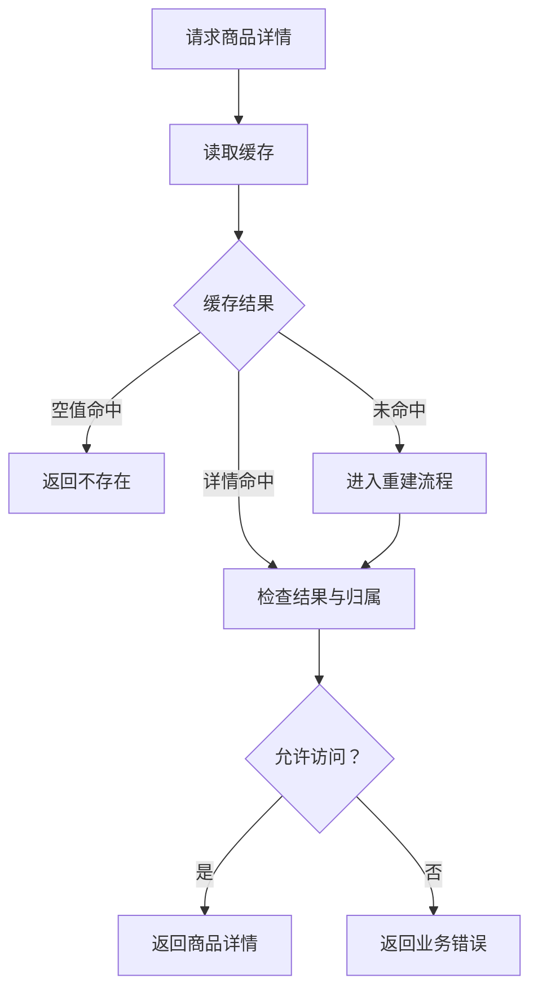
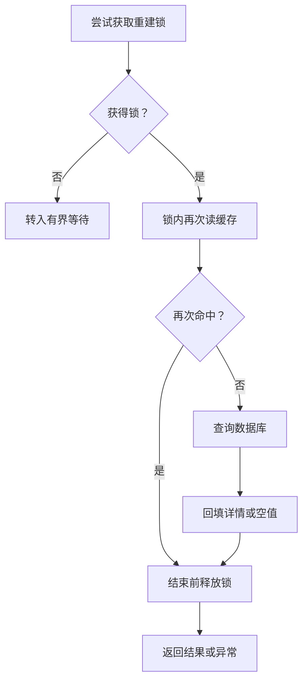
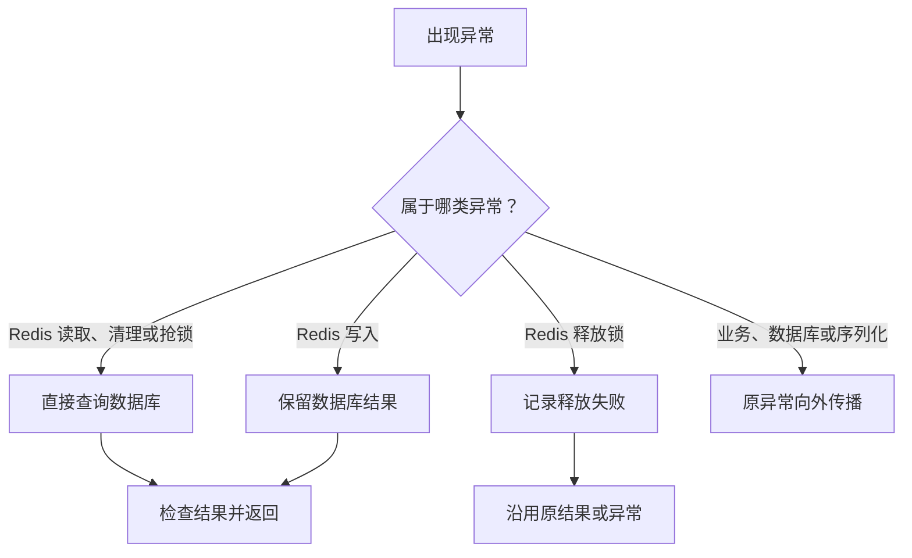
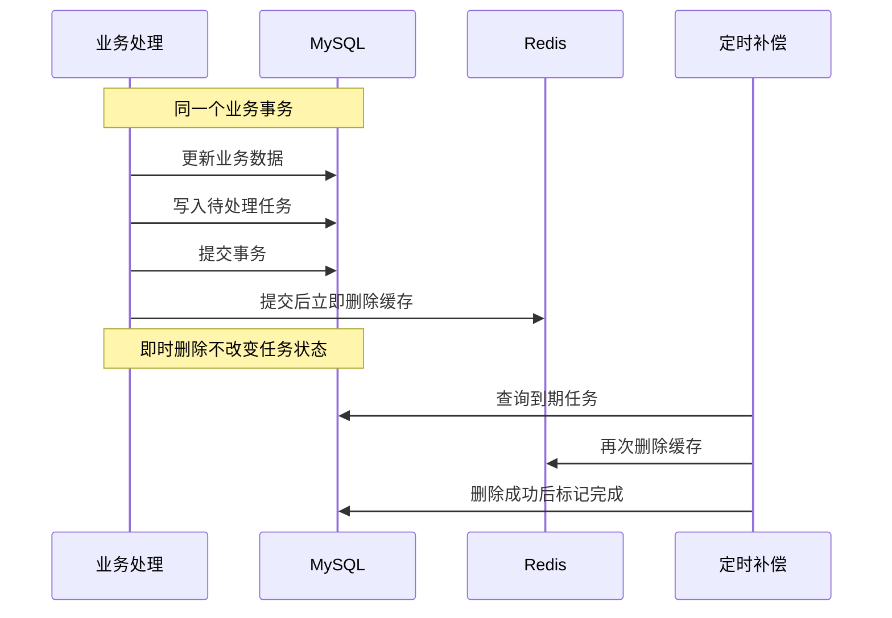

# 商品详情缓存

为商家详情查询减少数据库读取，并在商品变化后通过持久化任务补做缓存失效。

适用入口是商家接口 `GET /category/products/{id}`。顾客店铺浏览、购物车、结算和库存写入直接访问 MySQL，不经过本文详情缓存。

## 主流程：一次正常读取如何结束

这张图只区分详情命中、空值命中和未命中；重建和故障处理分别见下面的子流程。

重建正常返回（含 `null`）后检查结果与归属；重建抛出的异常不沿成功路径继续。空白缓存视为未命中；坏 JSON、反序列化结果为空或缺少 `inStock` 时，先删坏值，再按未命中处理。空值标记表示商品不存在，直接抛业务异常。详情不要求在售，但结果必须非空且属于当前商家。

源码：`ProductService.getProductDetail`、`ProductDetailCacheService.readProductDetailCache`，完整链接见末尾定位表。

## 子流程

### 缓存未命中后怎样安全重建

锁只协调同一个商品的重建请求；下图不展开等待循环或所有异常分支。

“再次命中”包含详情和空值标记：前者返回详情，后者报不存在；两者都先经过 `finally` 解锁。数据库查到商品才写详情，查不到则写空值标记并返回 `null`。**锁内的数据库、序列化或 Redis 读取异常也必须先解锁再传播**；回填失败的特殊处理见下一图。这里没有 MySQL 重建事务。

| 未取得锁后的分支 | 实际行为 |
| --- | --- |
| 等待后读到详情或空值 | 立即返回详情或报不存在，不再抢锁 |
| 仍未命中但抢到锁 | 进入图中的“锁内再次读缓存” |
| 等待轮次全部用尽 | 只有仍无缓存结果且未获锁，才报超时；不会直接回源 |
| 等待被中断 | 恢复中断标记，报业务异常，结束等待 |

首次抢锁失败后，最多等待 5 轮，每轮先等 100ms、重读缓存，仍未命中才再次抢锁。命中或获锁会提前结束，不把这个有界过程画成长回环线。

源码：`getProductDetailCache`、`resolveProductDetailCacheMiss`、`getProductDetailCacheDTO`；锁由 `RedisCacheClient.tryLock/unlock` 实现。

### 哪些故障会降级，哪些必须保留

这是异常分流图，不是这些异常依次发生的执行链。

上图前三个 Redis 分支仅指由封装层报告的 Redis 故障；具体类型和调用位置如下。若异常发生在持锁期间，先执行上一图的释放步骤。

| 来源 | 当前处理 |
| --- | --- |
| `GET`、清坏值的 `DEL`、`tryLock` 抛 `RedisCacheUnavailableException` | `ProductService` 捕获后直读 MySQL，再检查非空和商家归属；不回填缓存 |
| 重建后的 `SET`，包括写空值标记失败 | 缓存服务捕获同一异常并记日志，继续使用刚加载的结果；不发起第二次数据库查询 |
| 解锁调用抛异常 | 封装层记日志并返回 `false`，调用方忽略结果，不替换原结果或异常；仍存在但未释放的锁依赖租约到期 |
| 令牌不匹配或锁已过期 | 解锁正常返回 `false`，不记录异常日志；调用方同样忽略结果，不会删除其他请求的锁 |
| 空值命中、锁等待超时、中断、归属不符等业务异常 | 直接向外传播，不触发 MySQL 降级 |
| MySQL 查询失败、DTO 序列化失败 | 直接向外传播；不会被当成 Redis 故障兜底 |

源码：`ProductService.getProductDetail` 的捕获范围，以及 `writeProductDetailCache/writeNullProductDetailCache`、`RedisCacheClient` 的异常封装。

### 数据更新与后台补偿怎样衔接

这张短时序图只说明正常提交和后台再次失效的先后；失败策略放到图外。业务处理参与者合并表示写服务、失效任务服务及提交回调，不是新建的统一服务。

任务通过 `MANDATORY` 加入已有业务事务，不独立提交；任务 SQL 或业务操作抛异常则共同回滚，不执行提交后删除。立即删除成功也保留 PENDING，因此补偿是正常提交后的重复失效，不是出错后才补建任务。定时补偿没有领取锁或整个批次事务。

源码：`CacheInvalidationTaskService.requestInvalidation/retryPendingTasks/retryFailedTasks` 和调度器；具体更新条件见 Mapper。

## 关键设计说明

| 设计 | 原因及真实范围 |
| --- | --- |
| 锁内二次检查 | 防止等待锁期间其他请求已经填好缓存，避免重复回源 |
| 按令牌释放锁 | Lua 校验持有者后删除，避免释放别人的锁；无自动续期，不能阻止旧请求在租约过期后继续回填 |
| 缓存库存投影 | 只保存 `inStock`，不保存精确库存；订单扣减/归还只在库存跨有货边界时请求失效 |
| 任务与业务共同提交 | 确保已提交的数据变化有失效记录；MySQL 事务不覆盖 Redis |
| 延后重复删除 | 降低旧读回填的影响，但写入与失效不获取重建锁，不构成强一致屏障 |

| 参数 | 当前值 |
| --- | --- |
| 详情键 / 锁键 | `product:detail:{id}` / `Lock:product:detail:{id}` |
| 详情 / 空值 / 锁有效期 | 随机 50～70 分钟 / 随机 2～5 分钟 / 10 秒 |
| 空值标记 | `__NULL__` |
| 任务初次到期 | 创建任务时的应用时间 + 15 秒，**不是提交后固定再等 15 秒** |
| PENDING / FAILED 扫描间隔 | 方法完成后等待 10 秒 / 1 小时；每批最多 100 条，无查询排序保证 |
| worker 短期失败退避 | 第 1～4 次分别 10/30/60/120 秒；第 5 次转 FAILED 并保留上次到期时间 |
| FAILED 再失败 | 保持 FAILED，失败数增加，下次执行时间设为数据库当前时间 + 1 小时 |
| SUCCESS 历史清理 | 每轮完成后等待 1 小时，按创建时间、ID 升序清理创建已满 7 天的 SUCCESS，最多 1000 条；PENDING/FAILED 保留 |

商品新建、编辑、上下架、逻辑删除和恢复成功后请求失效；上下架即使无需改变状态也会请求。新建商品取得 ID 后，在创建事务内登记失效任务，提交后删除可能存在的空值缓存；不预热缓存。删除分类会在同一事务锁定并迁移包含逻辑删除行的商品，再逐商品请求失效。库存条件更新与版本、分类行锁的具体含义见 [模块依赖](07-module-dependencies.md) 和源码定位，不在缓存图重复展开。

## 异常与边界情况

| 场景 | 结果 |
| --- | --- |
| 提交后立即删缓存遇到 Redis 故障 | 只记日志；订单或商品更新已提交，PENDING 留待扫描 |
| worker 删除失败 | 写入对应退避；记录成功后继续下一条。即时删除失败不增加这个计数 |
| worker 状态更新不为 1 行或数据库异常 | 抛异常，中止当前剩余批次；不是每种异常都继续 |
| Redis key 已不存在 | 删除未抛异常就尝试标记 SUCCESS；不检查删除返回值 |
| 多实例扫到同一任务 | 可能重复删除、重复计失败数；状态条件不等于独占领取 |
| 旧数据库读取晚于补偿才回填 | 仍可能留下陈旧值，直至 TTL 或下一次失效；详见 [F02～F04、F11](06-findings.md) |

已确认以第 5 次 worker 失败转 FAILED 为准，测试已同步为 10/30/60/120 秒后转入低频重试；即时删除失败不参与计数。FAILED 仍会继续处理，不是终止或人工死信状态。阈值说明与测试定位见 [F01](06-findings.md)。

## 源码定位

| 源码 | 关键方法 / 用途 |
| --- | --- |
| [MerchantProductController](../../src/main/java/org/example/takeout/Product/Controller/MerchantProductController.java)、[AuthPathMatcher](../../src/main/java/org/example/takeout/Common/Auth/AuthPathMatcher.java) | `getDetail`；商家角色限制 |
| [ProductService](../../src/main/java/org/example/takeout/Product/Service/ProductService.java) | `getProductDetail`、`loadProductDetailFromMysqlOnly`；读取与降级、各商品写入口 |
| [ProductDetailCacheService](../../src/main/java/org/example/takeout/Product/Service/ProductDetailCacheService.java) | `readProductDetailCache`、`resolveProductDetailCacheMiss`、`getProductDetailCacheDTO`、`writeProductDetailCache`、`evictProductDetailCache` |
| [RedisCacheClient](../../src/main/java/org/example/takeout/Common/Redis/RedisCacheClient.java) | `get/set/delete/tryLock/unlock`；Redis 封装和令牌校验 |
| [CacheInvalidationTaskService](../../src/main/java/org/example/takeout/CacheInvalidationTask/Service/CacheInvalidationTaskService.java) | `requestInvalidation`、`createPending`、两个 `retry*Tasks`、`cleanupSuccessfulTasks` |
| [CacheInvalidationTaskMapper](../../src/main/java/org/example/takeout/CacheInvalidationTask/Mapper/CacheInvalidationTaskMapper.java)、[Scheduler](../../src/main/java/org/example/takeout/CacheInvalidationTask/Config/CacheInvalidationTaskScheduler.java) | 条件状态更新、失败退避和定时入口 |
| [ProductCommandService](../../src/main/java/org/example/takeout/Product/Service/ProductCommandService.java)、[ProductMapper](../../src/main/java/org/example/takeout/Product/Mapper/ProductMapper.java) | `evictCacheIfInStockChanged`、`migrateProductsToCategory`、库存与分类 SQL |
| [CategoryService](../../src/main/java/org/example/takeout/Category/Service/CategoryService.java) | `deleteById` 提供分类迁移事务和源分类锁 |
| [缓存 DTO](../../src/main/java/org/example/takeout/Product/Cache/ProductDetailCacheDTO.java)、[ProductConverter](../../src/main/java/org/example/takeout/Product/Mapper/ProductConverter.java) | 详情字段与 `hasStock` 投影 |
| [ProductQueryService](../../src/main/java/org/example/takeout/Product/Service/ProductQueryService.java) | 购物车、结算、店铺的直接数据库查询 |

