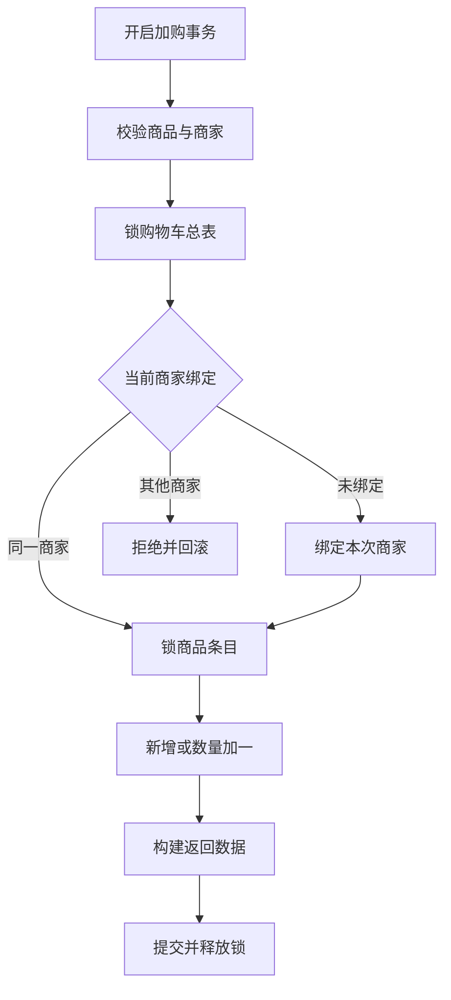
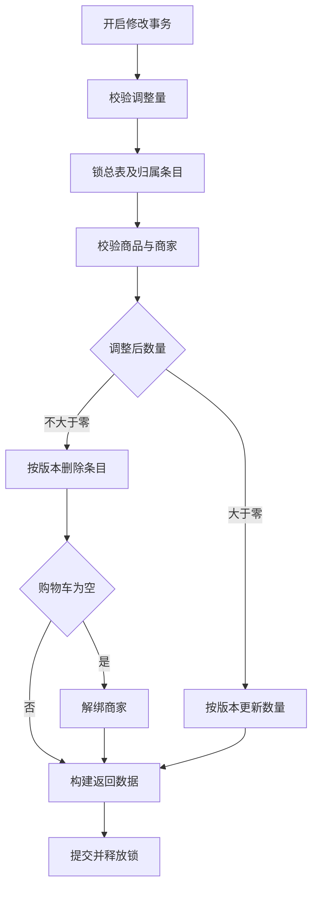
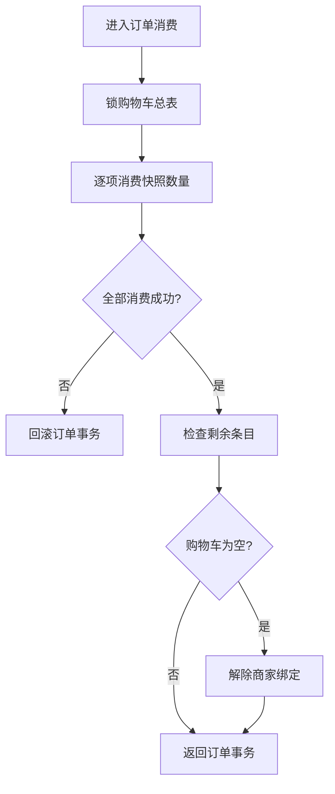

# 购物车：绑定、修改与下单消费

购物车保存单商家商品快照；下单按结算快照消费数量，并与订单、库存和明细一起提交或回滚。

本页依据 2026-10-26 工作区源码。运行链路使用 MySQL 的 `cart`、`cart_header`，实验目录的 Redis 购物车没有接入这些入口。先看加购主流程，再按需阅读数量修改、订单消费两张子图。

## 主流程：加购与商家绑定

此图回答：**空车如何绑定商家，已有绑定如何限制加购？**

`CartService.add` 的方法事务覆盖全部节点，包括锁前的商品、商家、库存预检；任一步骤抛出的异常都会回滚，不再继续后续节点。图中只单独画出商家冲突这一核心业务分支，其他失败见下表。

预检直接查询数据库，要求商品在售、商家营业、库存大于零，不读商品详情缓存。新条目保存名称、图片、价格快照；已有条目只增加数量和版本，不刷新快照。加购不预占库存，也不校验累计数量是否超库存。

## 子流程：数量修改与空车解绑

此图回答：**数量调整何时更新条目，何时删除并解绑？**

`CartService.update` 只允许数量变化 `+1/-1`。先锁总表，再按当前用户和条目 ID 锁明细；即使减一或减到零，也先要求商家营业、商品在售。更新、删除都要求影响一行，否则整个事务回滚。删除分支返回数量和小计为零的结果；构建返回值失败也会回滚。

批量删除与清空不必再画一张近似流程图：它们都先锁总表，在同一个方法事务中完成以下操作，且不要求商品在售或商家营业。

| 操作 | 锁后的步骤 | 空车与失败处理 |
| --- | --- | --- |
| 批量删除 | 按当前用户与请求 ID 删除 → 校验删除行数 → 判断剩余条目 | 行数须等于 ID 数，否则已删部分也回滚；空车解绑。HTTP 入口要求 ID 非空、为正数且不重复 |
| 清空 | 解绑商家 → 删除当前用户全部条目 | 一起提交或回滚；已有总表且本来未绑定时允许重复清空 |

## 子流程：下单怎样消费快照

此图回答：**怎样只消费本次快照，并判断是否解绑？** 订单、库存与明细的共同事务顺序统一见 [02 的短时序图](02-order-creation.md#2-子流程新订单怎样共同提交)，这里不重复绘制整条调用链。

“逐项消费”指每项依次条件扣量、检查影响行数、删除零数量条目；任一项失败立即退出，不会先处理完整车才检查错误。返回订单服务时还没有提交或释放锁；订单服务继续扣库存、写明细后，才由外层事务统一提交或回滚。解绑异常也会使该共同事务回滚。

结算准备在订单写事务外，无显式行锁：读取全车、商品和绑定商家。`OrderService.getCartItems` 要求全车非空且每项可用，存在一项不可用就拒绝整车，不做部分结算。计价使用准备时读取的商品价格和购物车数量，不使用列表展示的购物车价格快照；还检查数量、价格及金额上限 `1,000,000`。

`OrderTransactionExecutor.executeOrderCreation` 开启共同事务；`CartCommandService.consumeCheckedOutItems` 使用 `MANDATORY` 加入它，无外层事务时拒绝执行。任一消费、解绑、库存或明细操作失败，订单插入和此前的数据库修改全部回滚。获取的总表锁、明细写锁及商品写锁都保持到外层事务结束。

幂等重复请求返回既有订单时不会再次消费或扣库存；完整重放判断见 [02 订单创建](02-order-creation.md)。库存跨越有货/无货边界时登记缓存失效任务，任务加入订单事务，提交后的 Redis 处理见 [04 商品缓存](04-product-cache.md)。

## 关键设计说明

| 机制 | 真实作用与边界 |
| --- | --- |
| 单商家绑定 | `cart_header.user_id` 为主键，`merchant_id=NULL` 表示未绑定；`cart` 的唯一索引限制同用户同商品只有一行。总表与明细的商家一致性由应用流程维护，数据库没有跨表约束 |
| 总表锁 | 加购、修改、清空、非空 ID 批量删除及订单消费均先调用总表 `FOR UPDATE`，再操作明细；同用户写入在持锁期间等待。两个商家并发向空车加购，先成功提交的一方绑定，另一方被拒绝 |
| 初始化前提 | 注册事务创建总表，存量用户由迁移补齐；运行时不会懒创建。锁定查询缺行时只返回空结果，不补建；各入口后续处理并不一致，见下表 |
| 数量修改防冲突 | 明细先加行锁；正数量更新另用 `CartItem.@Version` 和 MyBatis-Plus 乐观锁插件，归零删除显式匹配旧版本。版本条件没有替代行锁 |
| 下单数量消费 | SQL 匹配条目 ID、当前用户及 `当前数量 >= 快照数量`，扣减数量并递增版本；**不匹配快照版本**。因此准备后加购可以留下增量，准备后减量可能拒绝 |
| 准备与写入分离 | 准备阶段不受总表锁协议保护；消费阶段再次检查数量，库存阶段再检查商品未删除、在售和库存足够。扣库存按商品 ID 升序竞争行锁，减到零转为售罄 |

## 异常与边界情况

### 正常展示与写入失败

| 场景 | 当前行为 |
| --- | --- |
| 加购预检失败、跨商家、绑定写入异常 | 抛异常，方法事务回滚；不继续写购物车 |
| 修改参数非法、条目不存在或不属于当前用户 | 拒绝；修改事务回滚。更新、删除、解绑和返回值构建失败也会整体回滚 |
| 商品失效或商家打烊 | 数量修改被拒绝；可用批量删除或清空清理。列表只标记不可用，不自动清理或解绑 |
| 购物车总表缺失 | 加购通过预检后会解引用空总表，空车首次加购也一样；列表仅在非空车路径解引用。结算准备返回默认空结果并由订单校验拒绝；其他写入口也不会补建，缺行处理并不统一 |
| 列表返回可购买 | 列表没有事务或行锁；只汇总可用项的快照金额，任一项不可用则整车不可买，且不检查库存数量。可购买不保证最终库存扣减成功 |
| 商家状态判断 | 加购、修改、列表要求明确营业；结算准备接受“商家存在且状态不等于打烊”。消费时不重查营业状态和商品价格，差异见 [06 问题与待确认事项](06-findings.md) |

源码注释称“刷新列表时会自动清理失效记录”，但 `CartService.list` 实际只标记不可用；图中保留实际行为，没有绘制自动清理。

### 准备快照之后的并发变化

以下变化均指在订单取得总表锁之前，其他请求已经提交的修改；取得锁后，同用户其他写请求等待订单事务结束。

| 已提交的变化 | 消费与事务结果 |
| --- | --- |
| 原条目从 5 件增到 6 件 | 消费快照 5 件，保留 1 件及商家绑定；版本变化本身不构成失败 |
| 新加另一商品 | 不在快照内，不被消费；最终检测到剩余条目便保留绑定 |
| 原条目从 5 件减到 4 件，或被删除 | 数量条件不满足或原 ID 不存在，消费影响零行，整个订单事务回滚 |
| 前一项消费成功，后一项或库存、明细失败 | 撤销本次订单及所有已做的购物车、绑定、库存和明细写入；其他事务此前已提交的修改保留 |
| 相同请求标识、相同参数重复下单 | 通过幂等校验后返回原订单，不消费后来加购的商品 |

## 源码定位

以下链接指向文件，反引号内给出关键方法，便于从简图回到具体实现。

| 主题 | 类、方法与路径 |
| --- | --- |
| HTTP 入口 | [CartController](../../src/main/java/org/example/takeout/Cart/Controller/CartController.java)：`add/list/updateQuantity/delete/deleteAll`，对应 `/cart/items` 的 POST/GET/PATCH/DELETE 与 `DELETE /cart/items/all` |
| 加购、修改与展示 | [CartService](../../src/main/java/org/example/takeout/Cart/Service/CartService.java)：`add/update/delete/clear/list/getCartVO`；四个写入口均为 `rollbackFor=Exception` 方法事务，列表无事务注解 |
| 绑定与行锁 | [CartHeaderManager](../../src/main/java/org/example/takeout/CartHeader/Manager/CartHeaderManager.java)：`lock/bindMerchant/unbindMerchant`；绑定、解绑为 `MANDATORY`。对应 [CartHeaderMapper](../../src/main/java/org/example/takeout/CartHeader/Mapper/CartHeaderMapper.java)：`lockCartHeader/bindMerchant/unbindMerchant` |
| 数量 SQL 与版本 | [CartMapper](../../src/main/java/org/example/takeout/Cart/Mapper/CartMapper.java)：`selectByUserIdAndProductIdForUpdate/addOrIncrease/consumeQuantity/deleteIfEmpty/existsByUserId`；[CartItem](../../src/main/java/org/example/takeout/Cart/Entity/CartItem.java) 的 `version`；[MybatisPlusConfig](../../src/main/java/org/example/takeout/Config/MybatisPlusConfig.java) 的 `mybatisPlusInterceptor` |
| 查询与结算准备 | [CartCheckoutService](../../src/main/java/org/example/takeout/Cart/Service/CartCheckoutService.java)：`prepareCheckout/isAvailable`；[ProductQueryService](../../src/main/java/org/example/takeout/Product/Service/ProductQueryService.java)：`findOnSaleProduct/selectProductsByIds`；[MerchantQueryService](../../src/main/java/org/example/takeout/Merchant/Service/MerchantQueryService.java)：`checkMerchantOpen/selectMerchantById` |
| 下单校验与共同事务 | [OrderService](../../src/main/java/org/example/takeout/Order/Service/OrderService.java)：`prepareOrderDataContext/getCartItems/calculateTotalAmount`；[OrderTransactionExecutor](../../src/main/java/org/example/takeout/Order/Service/OrderTransactionExecutor.java)：`executeOrderCreation`；[CartCommandService](../../src/main/java/org/example/takeout/Cart/Service/CartCommandService.java)：`consumeCheckedOutItems` |
| 库存与明细 | [OrderItemService](../../src/main/java/org/example/takeout/Order/Service/OrderItemService.java)：`decreaseStocksOrderedByProductId/buildOrderItems/saveBatch`；[ProductCommandService](../../src/main/java/org/example/takeout/Product/Service/ProductCommandService.java)：`decreaseStock`；[ProductMapper](../../src/main/java/org/example/takeout/Product/Mapper/ProductMapper.java)：`decreaseStock` |
| 初始化与结构 | [UserService](../../src/main/java/org/example/takeout/User/Service/UserService.java)：`register`；[总表补齐迁移](../../src/main/resources/db/migration/V20261010__cart_header_backfill.sql)；[deploy/schema.sql](../../deploy/schema.sql) |

既有 [总表回归测试](../../src/test/java/org/example/takeout/Cart/Service/CartHeaderServiceRegressionTest.java)、[消费 SQL 测试](../../src/test/java/org/example/takeout/Cart/Mapper/CartConsumptionMapperTest.java) 和 [订单购物车事务测试](../../src/test/java/org/example/takeout/Order/Service/OrderCartHeaderTransactionTest.java) 可用于继续核查锁、增量保留和回滚边界；本轮文档重构未运行业务测试。
