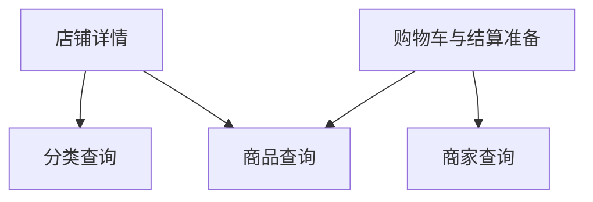
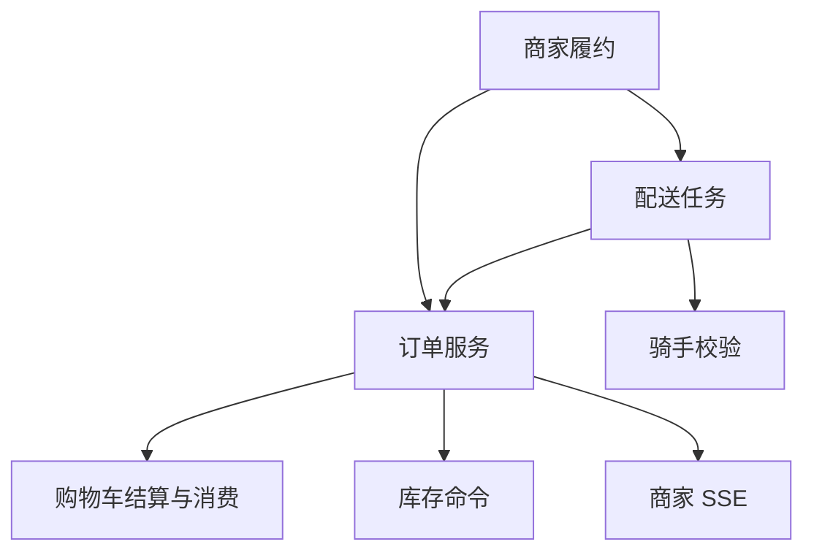
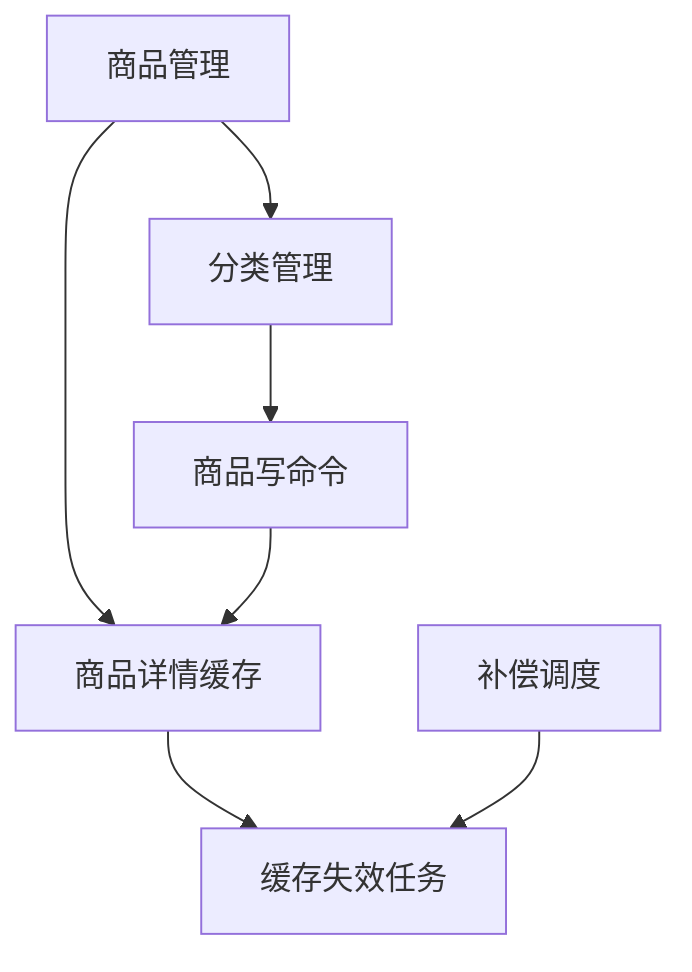
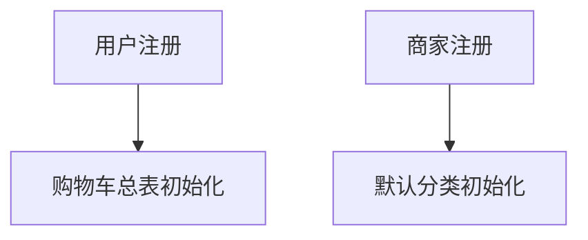
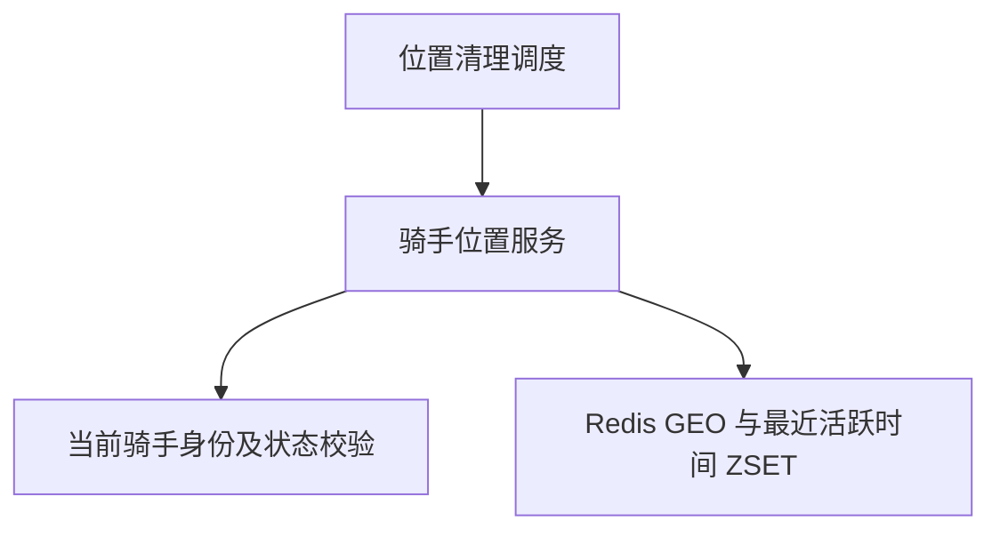
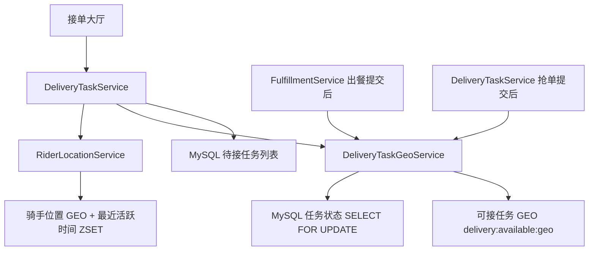

# 跨模块依赖：按主题阅读

这些小图回答“某项职责依赖谁”。箭头统一表示 **调用方 → 被调用方**，不表示执行顺序或事务范围；先看 [分层总览](01-system-overview.md)，再选择需要的主题。

节点可归并承担同一职责的多个现有类，仍属于同一 Spring Boot 应用；没有新增统一服务或事件总线。存储关系通常留在总览说明，GEO 专题补充必要的 MySQL/Redis 一致性边界。

## 1. 店铺浏览与购物车的只读查询

店铺详情与购物车复用商品查询能力，各自组织返回数据。

这里仅画跨模块查询依赖。店铺聚合直接查询商家；店铺商品、购物车与结算准备直接查库，不经过商品详情缓存。购物车节点包含写事务，图中的查询依赖不代表它整体只读。

源码定位：

| 图中职责 | 类与关键方法 |
| --- | --- |
| 店铺详情 | [CustomerShopQueryService](../../src/main/java/org/example/takeout/Merchant/Service/CustomerShopQueryService.java)：`getMerchantDetailWithGroupedProducts` 查询商品，`convertToCategoryVOList` 批量查询分类名 |
| 购物车与结算准备 | [CartService](../../src/main/java/org/example/takeout/Cart/Service/CartService.java)：`add/update/list`；[CartCheckoutService](../../src/main/java/org/example/takeout/Cart/Service/CartCheckoutService.java)：`prepareCheckout` |
| 查询能力 | [ProductQueryService](../../src/main/java/org/example/takeout/Product/Service/ProductQueryService.java)、[MerchantQueryService](../../src/main/java/org/example/takeout/Merchant/Service/MerchantQueryService.java)、[CategoryService.getCategoriesByIds](../../src/main/java/org/example/takeout/Category/Service/CategoryService.java) |

总表锁、版本校验和结算消费见 [05 购物车](05-cart.md)。

## 2. 订单、履约与配送

商家履约协调订单和配送；订单负责结算、库存及支付后的商家通知。

“订单服务”合并订单包内的编排、明细和状态命令；“商家履约”不包含商家 SSE，避免把不同职责误画成同一对 Bean 的循环依赖。商家订单展示另由 [MerchantOrderViewService](../../src/main/java/org/example/takeout/Merchant/Service/MerchantOrderViewService.java) 查询订单与明细、维护已读，未加入这张状态协作依赖图。

源码定位：

| 图中依赖 | 调用位置 |
| --- | --- |
| 履约 → 订单、配送 | [FulfillmentService.acceptOrder/rejectOrder/completePreparation](../../src/main/java/org/example/takeout/Merchant/Service/FulfillmentService.java) 调用 [OrderCommandService](../../src/main/java/org/example/takeout/Order/Service/OrderCommandService.java)、`DeliveryTaskService` |
| 配送 → 订单、骑手 | [DeliveryTaskService.claimTask/completeDelivery](../../src/main/java/org/example/takeout/DeliveryTask/Service/DeliveryTaskService.java) 调用订单状态命令/校验及 [RiderService.requireActiveRiderId](../../src/main/java/org/example/takeout/Rider/Service/RiderService.java) |
| 订单 → 购物车 | [OrderService.prepareOrderDataContext](../../src/main/java/org/example/takeout/Order/Service/OrderService.java) 调用结算准备；[OrderTransactionExecutor.executeOrderCreation](../../src/main/java/org/example/takeout/Order/Service/OrderTransactionExecutor.java) 调用消费命令 |
| 订单 → 库存、SSE | [OrderItemService](../../src/main/java/org/example/takeout/Order/Service/OrderItemService.java) 调用商品库存命令；`OrderService.payOrder` 提交后调用 [MerchantSseService.notifyNewOrder](../../src/main/java/org/example/takeout/Merchant/Service/MerchantSseService.java) |

事务不由图中的模块分组决定：创建准备在事务外，消费和扣库在创建事务内；出餐、抢单、送达各自保持订单与配送数据一致；SSE 在支付提交后执行。顺序与失败分支见 [02 订单创建](02-order-creation.md)、[03 订单状态与履约](03-order-lifecycle.md)。

## 3. 商品、分类与缓存补偿

商品管理校验分类，分类删除通过商品命令迁移商品；两条写入路径都能请求缓存失效。

这是一条 `ProductService → CategoryService → ProductCommandService` 依赖链，三者是不同 Bean。缓存失效请求在业务事务内写任务，删除 Redis 在提交后执行；调度器调用任务服务重试，没有消息队列或任务领取锁。

源码定位：

| 图中依赖 | 类与关键方法 |
| --- | --- |
| 商品 → 分类 | [ProductService.createProduct/applyProductUpdate](../../src/main/java/org/example/takeout/Product/Service/ProductService.java) 调用 [CategoryService.lockActiveCategory](../../src/main/java/org/example/takeout/Category/Service/CategoryService.java)；展示路径也复用分类查询 |
| 分类 → 商品写命令 | `CategoryService.deleteById` 调用 [ProductCommandService.migrateProductsToCategory](../../src/main/java/org/example/takeout/Product/Service/ProductCommandService.java) |
| 商品管理/写命令 → 详情缓存 | [ProductDetailCacheService.getProductDetailCache/evictProductDetailCache](../../src/main/java/org/example/takeout/Product/Service/ProductDetailCacheService.java)；库存命令仅在有货/无货边界变化时请求失效 |
| 缓存/调度 → 失效任务 | [CacheInvalidationTaskService.requestInvalidation/retryPendingTasks/retryFailedTasks](../../src/main/java/org/example/takeout/CacheInvalidationTask/Service/CacheInvalidationTaskService.java)、[CacheInvalidationTaskScheduler](../../src/main/java/org/example/takeout/CacheInvalidationTask/Config/CacheInvalidationTaskScheduler.java) |

缓存正常读取、锁内重建、Redis 故障降级和提交后补偿分别见 [04 商品缓存](04-product-cache.md)。

## 4. 账号注册的初始化依赖

用户注册创建购物车总表，商家注册创建默认分类；两项初始化互不依赖。

两项初始化分别加入对应的注册事务，初始化失败会回滚账号插入。购物车总表在注册时创建，并非首次加购时懒创建。

源码定位：

| 图中依赖 | 调用位置与边界 |
| --- | --- |
| 用户 → 购物车总表 | [UserService.register](../../src/main/java/org/example/takeout/User/Service/UserService.java) 开事务，调用 [CartHeaderManager.insertCartHeader](../../src/main/java/org/example/takeout/CartHeader/Manager/CartHeaderManager.java)；被调用方法为 `MANDATORY` |
| 商家 → 默认分类 | [MerchantAccountService.register](../../src/main/java/org/example/takeout/Merchant/Service/MerchantAccountService.java) 开事务，调用 [CategoryCommandService.createDefaultCategory](../../src/main/java/org/example/takeout/Category/Service/CategoryCommandService.java) |

购物车后续绑定、修改和消费见 [05 购物车](05-cart.md)；入口与存储见 [01 分层总览](01-system-overview.md)。

## 5. 骑手位置与 Redis GEO

骑手位置由 Redis GEO 保存，并与最近活跃时间 ZSET 一起更新。位置服务直接依赖 `RiderService` 验证当前登录骑手，不依赖配送任务、订单或派单服务。

[`RiderLocationController`](../../src/main/java/org/example/takeout/Rider/Controller/RiderLocationController.java) 暴露 `PUT/GET/DELETE /rider/location`，只使用当前登录骑手的身份，不接受客户端提供骑手 ID。`updateLocation` 还会要求上报 ID 与当前有效骑手一致，并校验经纬度；一个 Lua 脚本同时写入 `rider:locations` GEO 集合和 `rider:last_active` 活跃时间。单人位置读取和主动删除也由该服务提供；服务不提供附近骑手查询。

`RiderLocationCleanupScheduler` 使用 fixedDelay，每轮完成后等待 5 分钟。清理脚本删除最近活跃时间不晚于当前时间减 5 分钟的骑手，并同时从两个 Key 中移除；每轮至多运行 10 批、每批 100 个。超过当轮上限的积压留待后续调度轮次。位置读取不额外检查活跃时间，GEO 成员也没有单独 TTL；过期位置依赖清理调度实际移除。Redis GEO 调用失败会向调用方抛 `RedisGeoOperationException`；调度器记录清理异常并等待下一轮。

| 位置 | 代码与测试 |
| --- | --- |
| 服务 | [RiderLocationService](../../src/main/java/org/example/takeout/Rider/Service/RiderLocationService.java) |
| HTTP 入口 | [RiderLocationController](../../src/main/java/org/example/takeout/Rider/Controller/RiderLocationController.java)；[位置请求 DTO](../../src/main/java/org/example/takeout/Rider/DTO/UpdateRiderLocationDTO.java) |
| 过期清理 | [RiderLocationCleanupScheduler](../../src/main/java/org/example/takeout/Rider/Config/RiderLocationCleanupScheduler.java) |
| 行为验证源码 | [RiderLocationServiceTest](../../src/test/java/org/example/takeout/Rider/Service/RiderLocationServiceTest.java)、[RiderLocationServiceIntegrationTest](../../src/test/java/org/example/takeout/integration/RiderLocationServiceIntegrationTest.java)、[RiderLocationCleanupSchedulerTest](../../src/test/java/org/example/takeout/Rider/Config/RiderLocationCleanupSchedulerTest.java) |

## 6. 可接配送任务 GEO 与接单大厅

接单大厅同时读取本人位置、任务 GEO 候选和 MySQL 权威任务列表。出餐和抢单分别在 MySQL 提交后修复或移除任务索引。

商家可成对设置经纬度；出餐事务创建配送任务时，把商家当时的坐标复制到 `delivery_task.pickup_longitude/pickup_latitude`，商家之后修改店铺坐标不会改变已建任务的快照。没有坐标的历史任务或未配置坐标的新任务不进入任务 GEO。出餐事务提交后，若商家坐标已配置，`FulfillmentService` 按任务当前 MySQL 状态修复 GEO；GEO 写入失败只记录日志，不回滚已提交出餐结果。

`GET /rider/delivery-tasks/available` 默认按 5 公里查询 Redis GEO，最多取距离最近的 100 个候选。若查询有候选，服务仍从 MySQL 读取全部 `WAIT_ASSIGN` 且 `rider_id IS NULL` 任务：这 100 个候选按距离升序在前，其余任务按 ID 升序，结果不分页。骑手尚未上报位置时返回提示；骑手位置查询失败、任务 GEO 查询失败或半径内没有候选时，改按 MySQL 任务 ID 倒序查询最多 500 条。GEO 只影响排序，是否可接仍由 MySQL 状态决定。

抢单用 `READ_COMMITTED` 条件更新 MySQL 任务状态，事务提交后删除对应 GEO 成员；删除失败时再按任务的数据库状态对账。调度器默认启动后等待 10 分钟，之后每轮完成后等待 10 分钟。每轮一次读取 MySQL 全部待接任务和 Redis GEO 全部成员，尝试删除非规范成员，并计算两边任务 ID 的对称差集；差集中的 ID 逐个用独立 `REQUIRES_NEW`、`REPEATABLE_READ` 事务修复。事务通过 `SELECT ... FOR UPDATE` 锁住任务行，直至相应 Redis 写入或删除完成，以避免与抢单并发时按旧状态重写索引。单项修复失败只记录日志，留待后续调度轮次重试。两个集合都已有的任务 ID 不会再读取 Redis 坐标作比较，因此交集内坐标错误不会被全量对账纠正；单任务对账会根据 MySQL 快照执行 GEOADD 更新。

| 位置 | 代码 |
| --- | --- |
| HTTP 入口与大厅排序 | [DeliveryTaskController](../../src/main/java/org/example/takeout/DeliveryTask/Controller/DeliveryTaskController.java)、[DeliveryTaskService.getAvailableRiderTask](../../src/main/java/org/example/takeout/DeliveryTask/Service/DeliveryTaskService.java) |
| 出餐后的任务快照与 GEO 更新 | [FulfillmentService.completePreparation](../../src/main/java/org/example/takeout/Merchant/Service/FulfillmentService.java)、[DeliveryTaskService.createWaitingTask](../../src/main/java/org/example/takeout/DeliveryTask/Service/DeliveryTaskService.java) |
| GEO 服务、对账调度与全量查询 | [DeliveryTaskGeoService](../../src/main/java/org/example/takeout/DeliveryTask/Service/DeliveryTaskGeoService.java)、[DeliveryTaskGeoReconciliationJob](../../src/main/java/org/example/takeout/DeliveryTask/Config/DeliveryTaskGeoReconciliationJob.java)、[DeliveryTaskMapper.selectWaitAssignTasks](../../src/main/java/org/example/takeout/DeliveryTask/Mapper/DeliveryTaskMapper.java) |
